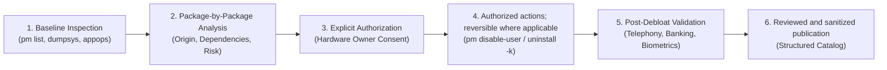

# Clean My Android — Technical Presentation of Method and Results

> **Surgical audit methodology, conscious debloating, evidence-based validation, and privacy governance for Android.**

---

## 1. Overview and Project Philosophy

**Clean My Android** documents a methodology for analyzing and carefully debloating Android devices. Instead of applying generic package lists, the project calls for device identification, package-level analysis, owner authorization, evidence recording, and bounded validation. The method does not eliminate all risks: incompatible changes can still affect essential functions.



### Core Principles
1. **Never Assume Universal Safety:** Android behavior varies significantly across OEMs (Motorola Hello UI, Samsung One UI, Xiaomi HyperOS), hardware chipsets (Qualcomm, MediaTek, Exynos), and firmware builds. No debloat action is universally safe.
2. **Evidence Over Inference:** Metrics should identify their source, command, date, collection conditions, and limitations. A single dump documents an observed state; it does not establish causation, permanent improvement, or future behavior.
3. **Planned Reversibility:** Prefer reversible actions and document the specific recovery command. Reversibility depends on the action, package, Android user, and firmware; `pm enable` and `cmd package install-existing` are not universal recovery methods and may not restore removed data or settings.
4. **Data Privacy:** The process requires review and sanitization of hardware identifiers, credentials, accounts, and network data before publication. Review reduces exposure risk but cannot guarantee the absolute absence of personal data.

---

## 2. Status Levels and Technical Homologation

To prevent reports from being misinterpreted as blanket approvals for other devices, the project implements a 5-level homologation taxonomy (detailed in [audit status and homologation standard](AUDIT_STATUS_AND_HOMOLOGATION.md)):

| Level | Classification | Minimum Evidence | Permitted Claim |
| :---: | :--- | :--- | :--- |
| **0** | **Unassessed** | Insufficient data to validate model or build | No safety or compatibility claim permitted |
| **1** | **Inventory Documented** | Hardware/firmware identity and raw package inventory with provenance | Inventory documented for the specific build |
| **2** | **Audit Reviewed** | Package rationale, dependencies, risks, protected list check, and PII sanitization | Technical review completed; no functional approval implied |
| **3** | **Functional Validation Completed** | Test matrix, before/after collection environment, and limitations recorded on hardware | Only listed functions and subsystems were tested successfully |
| **4** | **Script Homologated** | Dedicated script with hash/version, preflight checks, rollback, reproducible tests, and multi-user consensus | Script approved strictly for the declared model/build scope |

---

## 3. Audited Devices and Consolidated Results

The project currently documents **4 devices** across **2 OEMs**, covering **3 chipset architectures** and **3 major Android versions**:

| Device | Code / Codename | Chipset Platform | Android / UI | Homologation Level | Firmware Packages | Neutralized Packages | Enabled Post-Debloat |
| :--- | :--- | :--- | :--- | :---: | :---: | :---: | :---: |
| **Motorola Moto G54 5G** | `XT2343-1` · `cancunf` | MediaTek Dimensity 7020 | Android 15 · Hello UI | **Level 1** (Structured inventory) | 462 local | 433 published publicly | 394 system + 39 APEX |
| **Motorola Edge 60 Pro** | `XT2507-1` · `cybert` | Qualcomm Snapdragon (exact model pending confirmation) | Android unconfirmed · Hello UI | **Level 2** (Audit reviewed) | 501 mapped | 253 neutralized (60 factory-disabled + 184 via ADB + 9 uninstalled) | 248 preserved |
| **Motorola Edge 60 Fusion** | `scout_g_sysn` · `scout` | MediaTek Dimensity 7300 | Android 16 · Hello UI | **Level 3** (Subsystem validation) | 486 cataloged | 155 neutralized (67 pre-disabled + 88 via ADB) | 343 active for User 0 (includes 12 FOSS apps) |
| **Samsung Galaxy A30s** | `SM-A307GT` · `a30s` | Exynos 7904 | Android 11 · One UI 3.1 | **Level 3** (Validated subsystems) | 392 cataloged | 48 neutralized (46 ADB + 2 uninstalled) | 343 enabled (-12.3%) |

---

## 4. Key Platform Findings

### 4.1 Samsung Galaxy A30s (Exynos 7904 · One UI 3.1)
* **Commercial agent:** Disabled the *Digital Turbine Ignite* package (`com.dti.samsung`). The record proves the package-state change but does not, by itself, demonstrate that every background commercial installation mechanism was blocked.
* **Game Optimizing Service (GOS):** Disabled the package (`com.samsung.android.game.gos`). Without controlled frequency, temperature, and performance benchmarks, this does not establish that CPU/GPU limits were removed or thermal behavior restored.
* **Diagnostic components:** Deactivated *DiagMonAgent* (`com.sec.android.diagmonagent`) and *IMS Logger* (`com.sec.imslogger`). This affects these specific components; it does not prove that all Samsung, Google, or carrier telemetry was eliminated.
* **Honest Limitations:** Telephony, biometrics, and launcher remained fully intact; transparently recorded the loss of the native "Save as PDF" function caused by disabling the print spooler.

### 4.2 Motorola Edge 60 Fusion (Qualcomm Snapdragon · Hello UI)
* **FOSS Suite Adoption:** Replaced 12 proprietary Google/Motorola apps (Dialer, SMS, Calendar, Clock, Contacts) with privacy-respecting open-source alternatives (Fossify, FUTO, OpenCalc).
* **Dependency Analysis:** Discovered that Gemini (`com.google.android.apps.bard`) depends on the core host Google App (`com.google.android.googlequicksearchbox`), preserving both to avoid service breakage.
* **Banking validation:** The report records Banco Inter and Nubank checks during the documented session. This is a time-bounded observation, not a guarantee of future operation or a general certification of Google Play Integrity.

### 4.3 Motorola Edge 60 Pro (Flagship Qualcomm · Hello UI)
* **Framework mapping:** Initial inventory of 501 components and 18 conflicts with the basic protection list, documented with individual rationale and recovery guidance. The presence of recovery commands does not mean rollback was tested in every case.

### 4.4 Motorola Moto G54 5G (MediaTek Dimensity 7020)
* **Modular Batch Inventories:** 433 components cataloged across 7 technical batches (Google Ecosystem, Motorola Services, Commercial Partners, AOSP, Overlays, and Mainline APEX).

---

## 5. Automated Quality Assurance and Governance

The repository is protected by continuous automated CI checks that prevent data drift and regressions:

```text
Quality Automation Scripts:
├── scripts/generate_statistics.py    # Synchronizes metrics and device tables in root READMEs
├── scripts/validate_bilingual_parity.py # Enforces package, number, and file parity across PT-BR and EN
├── scripts/validate_repository.py     # Runs static checks; the count varies with repository contents
├── data/device_catalog.json          # Single source of truth for all integrated devices
└── data/protected_essential_packages.txt # Guardrail list protecting critical Android components
```

* **Automatic Synchronization:** Adding any new device to `data/device_catalog.json` immediately propagates to both English and Portuguese READMEs and statistics pages when running `generate_statistics.py`.
* **CI:** The workflow reports integrity and consistency failures. It does not access devices or prove functional results; merge blocking also depends on the repository's configured branch-protection rules.
