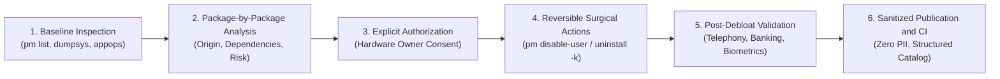

# Clean My Android — Technical Presentation of Method and Results

> **Surgical audit methodology, conscious debloating, evidence-based validation, and privacy governance for Android.**

---

## 1. Overview and Project Philosophy

**Clean My Android** establishes a technical standard for analyzing, cleaning (*debloating*), and optimizing Android devices. Unlike generic "one-click debloat" scripts that disable blind package lists and frequently cause bootloops, broken push notifications, or emergency call failures, the project is built upon rigorous, verifiable pillars:



### Core Principles
1. **Never Assume Universal Safety:** Android behavior varies significantly across OEMs (Motorola Hello UI, Samsung One UI, Xiaomi HyperOS), hardware chipsets (Qualcomm, MediaTek, Exynos), and firmware builds. No debloat action is universally safe.
2. **Evidence Over Inference:** No performance metric, RAM reduction, battery gain, or thermal claim is published without direct supporting ADB dumpsys logs.
3. **Strict Reversibility:** All packages are neutralized while keeping raw binaries intact on system partitions (`/system`, `/product`, `/vendor`), allowing immediate rollback via `pm enable` or `cmd package install-existing`.
4. **Data Privacy (Zero PII):** Hardware identifiers (IMEI, MAC address, serial number), user credentials, account names, and private network addresses are strictly sanitized prior to public release.

---

## 2. Status Levels and Technical Homologation

To prevent reports from being misinterpreted as blanket approvals for other devices, the project implements a 5-level homologation taxonomy (detailed in [docs/AUDIT_STATUS_AND_HOMOLOGATION.md](file:///home/luisfvmartins/clean-my-android/docs/AUDIT_STATUS_AND_HOMOLOGATION.md)):

| Level | Classification | Minimum Evidence | Permitted Claim |
| :---: | :--- | :--- | :--- |
| **0** | **Unassessed** | Insufficient data to validate model or build | No safety or compatibility claim permitted |
| **1** | **Inventory Documented** | Hardware/firmware identity and raw package inventory with provenance | Inventory documented for the specific build |
| **2** | **Audit Reviewed** | Package rationale, dependencies, risks, protected list check, and PII sanitization | Technical review completed; no functional approval implied |
| **3** | **Functional Validation Completed** | Test matrix, before/after collection environment, and limitations recorded on hardware | Only listed functions and subsystems were tested successfully |
| **4** | **Script Homologated** | Dedicated script with hash/version, preflight checks, rollback, reproducible tests, and multi-user consensus | Script approved strictly for the declared model/build scope |

---

## 3. Audited Devices and Consolidated Results

The project currently documents **4 devices** across **2 OEMs**, covering **3 chipset architectures** and **3 major Android versions**:

| Device | Code / Codename | Chipset Platform | Android / UI | Homologation Level | Firmware Packages | Neutralized Packages | Enabled Post-Debloat |
| :--- | :--- | :--- | :--- | :---: | :---: | :---: | :---: |
| **Motorola Moto G54 5G** | `XT2343-1` · `cancunf` | MediaTek Dimensity 7020 | Android 15 · Hello UI | **Level 1** (Structured inventory) | 462 local | 433 published publicly | 394 system + 39 APEX |
| **Motorola Edge 60 Pro** | `XT2507-1` · `cybert` | Snapdragon 8 Gen 3/4 | Android 16 (Dev) · Hello UI | **Level 2** (Reviewed audit) | 501 mapped | 253 neutralized (60 stock + 184 ADB + 9 uninstalled) | 248 preserved |
| **Motorola Edge 60 Fusion** | `scout_g_sysn` · `scout` | Snapdragon 7s Gen 2/3 | Android 16 · Hello UI | **Level 3** (Validated subsystems) | 486 cataloged | 155 neutralized (67 stock + 88 ADB) | 343 active (331 stock + 12 FOSS) |
| **Samsung Galaxy A30s** | `SM-A307GT` · `a30s` | Exynos 7904 | Android 11 · One UI 3.1 | **Level 3** (Validated subsystems) | 392 cataloged | 48 neutralized (46 ADB + 2 uninstalled) | 343 enabled (-12.3%) |

---

## 4. Key Platform Findings

### 4.1 Samsung Galaxy A30s (Exynos 7904 · One UI 3.1)
* **Silent Adware Neutralization:** Disabled *Digital Turbine Ignite* (`com.dti.samsung`), halting unauthorized background commercial APK downloads.
* **Throttling Removal:** Disabled *Game Optimizing Service (GOS)* (`com.samsung.android.game.gos`), eliminating artificial CPU/GPU frequency throttling without kernel tampering.
* **Telemetry Interruption:** Deactivated *DiagMonAgent* (`com.sec.android.diagmonagent`) and *IMS Logger* (`com.sec.imslogger`).
* **Honest Limitations:** Telephony, biometrics, and launcher remained fully intact; transparently recorded the loss of the native "Save as PDF" function caused by disabling the print spooler.

### 4.2 Motorola Edge 60 Fusion (Qualcomm Snapdragon · Hello UI)
* **FOSS Suite Adoption:** Replaced 12 proprietary Google/Motorola apps (Dialer, SMS, Calendar, Clock, Contacts) with privacy-respecting open-source alternatives (Fossify, FUTO, OpenCalc).
* **Dependency Analysis:** Discovered that Gemini (`com.google.android.apps.bard`) depends on the core host Google App (`com.google.android.googlequicksearchbox`), preserving both to avoid service breakage.
* **Banking Validation:** Confirmed that Banco Inter and Nubank operate properly with Google Play Integrity verified in session.

### 4.3 Motorola Edge 60 Pro (Flagship Qualcomm · Hello UI)
* **Advanced Framework Mapping:** Inventory of 501 components. 18 packages conflicting with basic protection lists were documented transparently with individual risk analysis and rollback commands.

### 4.4 Motorola Moto G54 5G (MediaTek Dimensity 7020)
* **Modular Batch Inventories:** 433 components cataloged across 7 technical batches (Google Ecosystem, Motorola Services, Commercial Partners, AOSP, Overlays, and Mainline APEX).

---

## 5. Automated Quality Assurance and Governance

The repository is protected by continuous automated CI checks that prevent data drift and regressions:

```text
Quality Automation Scripts:
├── scripts/generate_statistics.py    # Synchronizes metrics and device tables in root READMEs
├── scripts/validate_bilingual_parity.py # Enforces package, number, and file parity across PT-BR and EN
├── scripts/validate_repository.py     # Executes 440+ integrity checks (links, JSON schemas, homologation levels)
├── data/device_catalog.json          # Single source of truth for all integrated devices
└── data/protected_essential_packages.txt # Guardrail list protecting critical Android components
```

* **Automatic Synchronization:** Adding any new device to `data/device_catalog.json` immediately propagates to both English and Portuguese READMEs and statistics pages when running `generate_statistics.py`.
* **Blocking CI:** PRs fail automatically if links are broken, numbers diverge across languages, or declared homologation levels lack evidence files.
