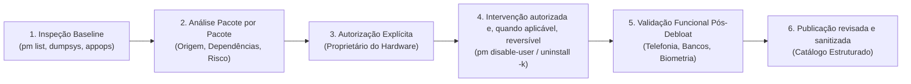

# Clean My Android — Apresentação Técnica do Método e Resultados

> **Metodologia de auditoria cirúrgica, debloat consciente, validação por evidências e governança de privacidade para Android.**

---

## 1. Visão Geral e Filosofia do Projeto

O **Clean My Android** documenta uma metodologia para análise e debloat criterioso de dispositivos Android. Em vez de aplicar listas genéricas de pacotes, o projeto propõe identificação do aparelho, análise individual, autorização do proprietário, registro de evidências e validação delimitada. O método não elimina todos os riscos: alterações incompatíveis ainda podem causar falhas, inclusive em funções essenciais.



### Princípios Irrenunciáveis
1. **Nunca Presumir Segurança Universal:** Android varia radicalmente entre fabricantes (Motorola Hello UI, Samsung One UI, Xiaomi HyperOS), arquiteturas de chip (Qualcomm, MediaTek, Exynos) e versões de firmware. Nenhuma intervenção é universalmente segura.
2. **Evidência sobre Inferência:** Métricas devem indicar fonte, comando, data, condições de coleta e limitações. Um dump isolado documenta um estado observado; não comprova causalidade, ganho permanente ou comportamento futuro.
3. **Reversibilidade Planejada:** Prefira ações reversíveis e registre o comando específico de recuperação. A reversão depende do tipo de ação, do pacote, do usuário Android e do firmware; `pm enable` e `cmd package install-existing` não são soluções universais e não recuperam necessariamente dados ou configurações removidos.
4. **Proteção de Dados Pessoais:** O processo exige revisão e sanitização de identificadores, credenciais, contas e dados de rede antes da publicação. A revisão reduz o risco de exposição, mas não permite prometer ausência absoluta de dados pessoais.

---

## 2. Níveis de Status e Homologação Técnica

Para evitar que a simples publicação de um relatório seja interpretada como uma homologação definitiva de procedimentos, o projeto adota uma taxonomia formal em 5 níveis (conforme [padrão de níveis de status e homologação](AUDIT_STATUS_AND_HOMOLOGATION.pt-BR.md)):

| Nível | Classificação | Evidência Exigida | Declaração Permitida |
| :---: | :--- | :--- | :--- |
| **0** | **Não Avaliado** | Dados insuficientes para validar o modelo ou compilação | Nenhuma alegação de segurança ou compatibilidade |
| **1** | **Inventário Documentado** | Identificação completa do hardware/firmware e inventário bruto de pacotes com proveniência | Inventário documentado para o dispositivo/build específico |
| **2** | **Auditoria Revisada** | Justificativa técnica pacote por pacote, dependências, riscos, checagem contra lista protegida e sanitização de PII | Análise técnica revisada; sem aprovação funcional implícita |
| **3** | **Validação Funcional Concluída** | Matriz de testes funcionais, ambiente de medição antes/depois e limitações registradas no aparelho físico | Apenas as funções e subsistemas listados foram testados com sucesso |
| **4** | **Script Homologado** | Script específico com hash/versão, pré-checagens, rollback, testes funcionais repetíveis e aprovação comunitária | Script aprovado estritamente para o escopo e modelo declarados |

---

## 3. Dispositivos Auditados e Resultados Consolidados

O repositório documenta atualmente **4 dispositivos** de **2 fabricantes**, abrangendo **3 plataformas de processamento** e **3 versões principais do Android**:

| Dispositivo | Código / Codinome | Plataforma (SoC) | Android / UI | Nível de Homologação | Pacotes Firmware | Alterados / Desativados | Habilitados Pós-Debloat |
| :--- | :--- | :--- | :--- | :---: | :---: | :---: | :---: |
| **Motorola Moto G54 5G** | `XT2343-1` · `cancunf` | MediaTek Dimensity 7020 | Android 15 · Hello UI | **Nível 1** (Inventário estruturado) | 462 locais | Inventário público: 433 | 394 sistema + 39 APEX |
| **Motorola Edge 60 Pro** | `XT2507-1` · `cybert` | Qualcomm Snapdragon (modelo exato pendente) | Android não confirmado · Hello UI | **Nível 2** (Auditoria revisada) | 501 mapeados | 253 alterados (60 fábrica + 184 ADB + 9 desinstalados) | 248 preservados |
| **Motorola Edge 60 Fusion** | `scout_g_sysn` · `scout` | MediaTek Dimensity 7300 | Android 16 · Hello UI | **Nível 3** (Validação funcional de subsistemas) | 486 catalogados | 155 alterados (67 pré-desativados + 88 via ADB) | 343 ativos no Usuário 0 (inclui 12 FOSS) |
| **Samsung Galaxy A30s** | `SM-A307GT` · `a30s` | Exynos 7904 | Android 11 · One UI 3.1 | **Nível 3** (Validação funcional) | 392 catalogados | 48 alterados (46 ADB + 2 desinstalados) | 343 habilitados (-12,3%) |

---

## 4. Destaques Técnicos por Plataforma

### 4.1 Samsung Galaxy A30s (Exynos 7904 · One UI 3.1)
* **Agente comercial:** Desativação do pacote *Digital Turbine Ignite* (`com.dti.samsung`). O registro comprova a alteração do pacote, mas não demonstra, por si só, o bloqueio de todos os mecanismos de instalação comercial em segundo plano.
* **Game Optimizing Service (GOS):** O pacote (`com.samsung.android.game.gos`) foi desativado. Sem benchmarks controlados de frequência, temperatura e desempenho, não se afirma que limites de CPU/GPU tenham sido removidos ou que o comportamento térmico tenha sido restaurado.
* **Componentes de diagnóstico:** Foram suspensos *DiagMonAgent* (`com.sec.android.diagmonagent`) e *IMS Logger* (`com.sec.imslogger`). Isso limita esses componentes específicos; não comprova a eliminação de toda a telemetria Samsung, Google ou da operadora.
* **Estabilidade e Limitações Honestas:** Subsistemas vitais de telefonia, biometria e interface One UI preservados; ressalva documentada sobre a perda da função "Salvar como PDF" decorrente da desativação do spooler de impressão nativo.

### 4.2 Motorola Edge 60 Fusion (Qualcomm Snapdragon · Hello UI)
* **Substituição Consciente por Alternativas FOSS:** 12 aplicativos proprietários da Google/Motorola (Discador, Mensagens, Calendário, Calculadora, Contatos) foram substituídos por versões de código aberto da suíte Fossify, FUTO e OpenCalc.
* **Preservação de Dependências Críticas:** Descoberta arquitetural de que o aplicativo Gemini (`com.google.android.apps.bard`) depende internamente do motor hospedeiro no Google App (`com.google.android.googlequicksearchbox`), levando à sua preservação deliberada para evitar quebras.
* **Validação bancária:** O relatório registra testes do Banco Inter e Nubank durante a sessão documentada. O resultado é pontual e não constitui garantia de funcionamento futuro nem certificação geral da Google Play Integrity API.

### 4.3 Motorola Edge 60 Pro (Flagship Qualcomm · Hello UI)
* **Mapeamento de framework:** Inventário inicial de 501 componentes e registro de 18 conflitos com a lista básica de proteção, acompanhados de justificativas e orientações de recuperação no relatório. A existência de comandos de recuperação não equivale a teste de reversão para todos os casos.

### 4.4 Motorola Moto G54 5G (MediaTek Dimensity 7020)
* **Inventário Modular em Lotes:** 433 componentes públicos categorizados e documentados em 7 lotes técnicos especializados (Ecossistema Google, Serviços Motorola, Parceiros Comerciais, AOSP, Overlays e Módulos APEX Mainline).

---

## 5. Garantia de Qualidade e Governança Automatizada

O repositório é sustentado por uma esteira de automação contínua (CI) que impede regressões documentais ou técnicas:

```text
Scripts de Automação e Qualidade:
├── scripts/generate_statistics.py    # Sincroniza métricas e tabelas de dispositivos nos READMEs principais
├── scripts/validate_bilingual_parity.py # Assegura paridade e equivalência de pacotes/números entre PT-BR e EN
├── scripts/validate_repository.py     # Executa verificações estáticas; a quantidade varia conforme os arquivos do repositório
├── data/device_catalog.json          # Fonte única da verdade estruturada para todos os dispositivos integrados
└── data/protected_essential_packages.txt # Lista protegida contra desativação de componentes vitais do sistema
```

* **Sincronização Automática:** Qualquer novo dispositivo adicionado a `data/device_catalog.json` é automaticamente refletido nos READMEs em português e inglês e nas páginas de estatísticas ao executar `generate_statistics.py`.
* **CI:** O workflow sinaliza falhas de integridade e consistência. Ele não acessa aparelhos nem comprova resultados funcionais; o bloqueio de merge depende também das regras de proteção configuradas no GitHub.
