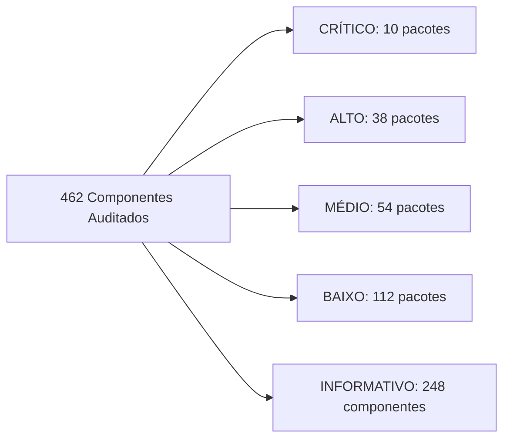

# Relatório Forense Integral de Auditoria de Pacotes, Segurança, Privacidade, Permissões, Telemetria e Ecossistema FOSS — Motorola Moto G54 5G (`cancunf` / Android 15)

> [!IMPORTANT]
> **Versão pública sanitizada:** detalhes dos 29 aplicativos instalados pelo usuário, IPs e portas de rede foram omitidos. A cópia integral local deve permanecer privada.
> **Escopo da coleta:** a auditoria local registrou 462 componentes: 423 pacotes APK/static-library/overlays RRO e 39 módulos APEX. Para preservar a privacidade, a versão pública omite os 29 aplicativos instalados pelo usuário e publica somente os 394 componentes de sistema/fabricante do inventário JSON.
>
> **Escopo de execução:** a coleta descrita como auditoria foi somente leitura. As operações anteriores citadas no histórico são registros retrospectivos, não instruções nem autorização para repeti-las.

---

## 1. Resumo Executivo da Auditoria

A inspeção forense profunda do **Motorola Moto G54 5G (Android 15)** revelou um cenário técnico fascinante e de alta complexidade:

1. **Histórico de Debloat Prévio via ADB (`shell:1000`) e Seus Efeitos Colaterais:**
   - O dispositivo já passou anteriormente por um script de desativação via ADB (`pm disable-user --user 0`), que colocou **162 pacotes** (130 aplicativos/serviços de sistema + 32 overlays RRO) no estado `enabled=3` (`DISABLED_USER`, `lastDisabledCaller: shell:1000`), além de **10 aplicativos** desativados manualmente via interface (`com.android.settings`).
   - **Pontos positivos desse debloat prévio:** Diversos pacotes severos de bloatware e telemetria já estão desativados, incluindo Meta App Manager/Services/System (`com.facebook.*`), InMobi Glance (`com.glance.lockscreenM`), Taboola (`com.taboola.mip`), Digital Turbine (`com.dti.motorola`), ironSource Aura (`com.aura.oobe.motorola`), PayJoy (`com.payjoy.access`), Amazon AppManager (`com.amazon.appmanager`), Motorola Analytics (`com.motorola.analytics.logger`), MotoCare (`com.motorola.motocare`), Bug2Go (`com.motorola.bug2go`) e os módulos de anúncios do Android 15 (`com.google.android.adservices.api` e `com.google.android.ondevicepersonalization.services`).
   - **PROBLEMA CRÍTICO 1 — Danos Colaterais a Componentes Essenciais do Sistema:** O script anterior desativou acidentalmente pacotes vitais de segurança, criptografia, áudio e sistema que **não possuem telemetria** (vários nem sequer têm a permissão `INTERNET`), causando falhas silenciosas ou degradação:
     - **`com.android.rkpdapp` (Remote Key Provisioning Daemon App):** **CRÍTICO!** Responsável pela rotação de chaves criptográficas de atestação de hardware KeyMint/StrongBox junto ao HSM do SoC. Sem ele, quando o lote de chaves em cache expirar, a verificação **Play Integrity (`MEETS_STRONG_INTEGRITY` / `MEETS_DEVICE_INTEGRITY`) falhará**, quebrando aplicativos bancários brasileiros (**aplicativo bancário**, Pix, serviço governamental) e carteira digital!
     - **`com.android.companiondevicemanager`:** Serviço oficial AOSP necessário para autenticação **Passkeys (FIDO2/WebAuthn)** via QR/Bluetooth e pareamento de relógios/rastreadores.
     - **`com.android.settings.intelligence`:** Indexador **100% offline** (não declara a permissão `INTERNET`!) da barra de busca do aplicativo Configurações. Desativá-lo quebra a busca em Configurações sem nenhum ganho de privacidade.
     - **`com.dolby.daxservice` e `com.motorola.dolby.dolbyui`:** Como `com.dolby.daxservice` possui a flag `FLAG_PERSISTENT`, o `ActivityManagerService` ignora o `enabled=3` e **continua executando o processo em RAM (`PID 2493`, 21,5 MB PSS)**, mas o áudio fica sem equalização adequada e a interface Dolby Atmos falha ao abrir. E nenhum dos dois tem permissão `INTERNET`!
     - **`com.android.printspooler`** (quebra a função nativa *"Salvar como PDF"*), **`com.android.providers.contactkeys`** (armazenamento local de chaves públicas E2EE do Android 15, sem `INTERNET`), **`com.android.providers.userdictionary`** (dicionário pessoal offline, sem `INTERNET`), **`com.motorola.nfwlocationattribution`** (atribuição de uso de GPS de baixo nível no Painel de Privacidade, sem `INTERNET`).
2. **PROBLEMA CRÍTICO 2 — Daemons de Telemetria "Zumbis" (`FLAG_PERSISTENT`) que Ignoram `pm disable-user`:**
   - No Android Internals, pacotes de sistema compilados com `ApplicationInfo.FLAG_PERSISTENT` são inicializados por `ActivityManagerService.startPersistentApps()` independentemente de estarem com `enabled=3` (`DISABLED_USER`), a menos que sejam desinstalados para o usuário atual (`remoção de pacote para o usuário (não recomendada sem validação)`).
   - **Evidência real em execução:**
     - **`com.motorola.android.nativedropboxagent`** está marcado como `enabled=3` (`lastDisabledCaller: shell:1000`), mas **continua rodando em segundo plano neste exato momento sob o `PID 30253` (UID `1007` `android.uid.log`, consumindo 4,2 MB de RAM PSS)**, monitorando crashes nativos (`/data/tombstones` e `DropBoxManager`)!
     - **`com.motorola.bach.modemstats`** está marcado como `enabled=3`, mas mantém **4 serviços ativos registrados no `ActivityManager`** (`ModemStatsService`, `LinkLatencyService`, `SmartNotificationService`, `ModemFilterService`).
3. **PROBLEMA CRÍTICO 3 — Agentes de Telemetria, Gerenciamento Remoto e Instaladores Silenciosos Ainda HABILITADOS:**
   - **`com.motorola.ccc.devicemanagement` (`3c_devicemanagement-binary`):** Está **HABILITADO (`enabled=0`)** e rodando **3 serviços ativos** (`.SystemServerBindService`, `BlurServiceMother` e `com.motorola.ccc.checkin.CheckinService`) com permissões de nível de sistema (`READ_LOGS`, `READ_DROPBOX_DATA`, `READ_NOTIFICATIONS`, `PACKAGE_USAGE_STATS`, `READ_PRIVILEGED_PHONE_STATE`, `INTERNET`), comunicando-se com a nuvem `blur`/`checkin` da Motorola!
   - **`com.motorola.installer` (`Moto Installer`):** Está **HABILITADO (`enabled=0`)** com `INSTALL_PACKAGES` (instalação silenciosa de APKs), `READ_PRIVILEGED_PHONE_STATE`, `QUERY_ALL_PACKAGES` e `INTERNET`.
   - **`com.bluetooth.aptxmode` (`aptxmode`):** Disfarçado pelo nome como um configurador de codec aptX, a inspeção de `dumpsys activity services` revelou que ele roda em modo **`FLAG_PERSISTENT` (`PID 2480`, 9,3 MB PSS)** o serviço **`com.motorola.bluetooth.motobtmetrics.MotoBtMetricsService`**, dotado das permissões **`com.motorola.permission.ACCESS_CHECKIN`** e **`QUERY_ALL_PACKAGES`**, enviando telemetria de dispositivos Bluetooth conectados para o Checkin da Motorola!
   - **`com.motorola.paks.notification`:** Gatilho Direct Boot de notificações push para o daemon de bloqueio remoto de aparelhos financiados (`PAKS`), ainda habilitado (`enabled=0`).
   - **`com.motorola.IncrementalUpdater`:** Serviço `3c_ota` paralelo ao `com.motorola.ccc.ota` que ainda está habilitado (`enabled=0`) com `READ_LOGS` e `READ_PRIVILEGED_PHONE_STATE`.
4. **Privacidade da publicação:** os 29 aplicativos instalados pelo usuário foram excluídos do inventário público; seus detalhes permanecem fora do repositório.
5. **Permissões e estado do sistema:** as recomendações de alteração foram substituídas por validação individual. Nenhum pacote deve ser desativado apenas por inferência de telemetria.

---

## 2. Fase 1 — Identificação Completa do Dispositivo

Dados extraídos diretamente via `adb shell getprop`, `dumpsys user`, `dumpsys role`, `dumpsys telecom`, `dumpsys window`, `free -h` e `df -h`:

| Parâmetro Técnico | Valor Identificado no Dispositivo (Evidência ADB) |
|---|---|
| **Fabricante / Marca** | Motorola (`motorola`) |
| **Modelo Comercial / Técnico** | `moto g54 5G` / `XT2343-1` |
| **Codinome da Placa / Produto** | Device/Board: `cancunf` — Product: `cancunf_g_sysn` |
| **Canal de Distribuição (Carrier)** | `retbr` (Retail Brasil — Sem vínculo de bloqueio de operadora) |
| **Hardware / SoC** | MediaTek Dimensity 7020 (`MT6855`, `arm64-v8a`, 8 núcleos) |
| **Versão do Android** | **Android 15** (API Level / SDK `35`) |
| **Build ID / Incremental** | `V1TDS35H.83-20-5-8-2-1-3` (`028f9-4a5f9`) |
| **Fingerprint da ROM** | `motorola/cancunf_g_sysn/cancunf:15/V1TDS35H.83-20-5-8-2-1-3/028f9-4a5f9:user/release-keys` |
| **Tipo de ROM / Assinatura** | Stock ROM Oficial Motorola (`user` build, assinada com `release-keys`) |
| **Patch de Segurança Android** | `2026-09-01` |
| **Estado de Root e Bootloader** | **Sem Root** (`su` inexistente; `ro.debuggable=0`; `ro.secure=1`; Bootloader trancado `ro.boot.vbmeta.device_state=locked`; Verified Boot `green`; `dm-verity=enforcing`; SELinux `Enforcing`) |
| **Criptografia de Armazenamento** | File-Based Encryption (FBE) ativa (`ro.crypto.state=encrypted`, `file`, `aes-256-cts`) |
| **Usuários e Perfis Ativos** | Apenas 1 usuário: `UserInfo{0:Rebecca:4c13}` (Sem Perfil de Trabalho / Sem Espaço Seguro ativo) |
| **Operadora / Conectividade** | `provedor de rede` (MCC/MNC `72429`, Brasil — LTE/5G ativo) |
| **DNS Privado (DoT)** | Ativo na porta TCP `853` (`[IP:PORTA OMITIDOS]` — DNS da operadora/provedor provedor de rede via `dns_resolv`) |
| **Launcher Padrão (`HOME`)** | `com.motorola.launcher3` (Moto App Launcher — Provedor QuickStep) |
| **Teclado Padrão (`IME`)** | `com.google.android.inputmethod.latin` (Gboard) + `com.google.android.tts` (Google Voice Typing habilitado) |
| **Discador Padrão (`DIALER`)** | `com.google.android.dialer` (Telefone do Google) |
| **App de SMS Padrão (`SMS`)** | `com.google.android.apps.messaging` (Google Mensagens) |
| **Navegador Padrão (`BROWSER`)** | `com.android.chrome` (Google Chrome) |
| **Galeria Padrão (`GALLERY`)** | `com.google.android.apps.photos` (Google Fotos) |
| **Assistente Digital Padrão** | Nenhum (`none` — Google App encontra-se desativado) |
| **Memória RAM e ZRAM** | **8 GB RAM** (`7.621.844 KB` total): `3,95 GB` usados (App PSS + Kernel), `3,39 GB` em cache/livre; Swap ZRAM: `1,5 GB` usados de `4,0 GB` |
| **Armazenamento Interno (`/data`)** | **87% Ocupado** — `198 GB` usados de `231 GB` totais (`32 GB` livres) |

---

## 3. Fase 2 — Estatísticas Gerais e Inventário Forense dos Pacotes

A correlação entre `pm list packages -u`, `dumpsys package`, `dumpsys appops`, `dumpsys activity services`, `dumpsys meminfo` e `dumpsys diskstats` produziu os seguintes indicadores globais:

| Métrica do Inventário | Quantidade | Detalhamento Técnico |
|---|---|---|
| **Total Geral de Componentes Auditados** | **462** | **423 pacotes APK/static-library** em `dumpsys package` + **39 módulos APEX ativos** |
| **Pacotes de Sistema (`/system`, `/product`, `/system_ext`, `/vendor`, `/apex`)** | **394** | 267 pacotes funcionais de sistema + 127 pacotes de recursos estáticos RRO (Overlays) |
| **Aplicativos Instalados pelo Usuário (`/data/app`)** | **29** | 28 instalados via Google Play Store (`com.android.vending`) + 1 via Sideload (`com.google.android.packageinstaller`: `com.Alternative.Mystery.Tracker`) |
| **Pacotes Atualmente Habilitados (`enabled=0` ou `1`)** | **203** | 131 pacotes de sistema/usuário + 72 overlays RRO ativos |
| **Pacotes Atualmente Desativados (`enabled=2`, `3` ou `4`)** | **220** | **162** via ADB (`shell:1000`, `enabled=3`), **10** via Configurações (`com.android.settings`, `enabled=3`), **47** pelo script regional Motorola (`EnableDisableApps_2`, `enabled=2`), **1** em estado `DISABLED_UNTIL_USED` (`enabled=4`: `com.android.dreams.basic`) |
| **Módulos Project Mainline / Sistema Ativos (APEX)** | **39** | 37 módulos AOSP/Google Mainline + 2 módulos proprietários Motorola (`com.motorola.enterprise`, `com.motorola.motosecure`) |
| **Identidades Compartilhadas (`sharedUserId`)** | **7 grupos** | `android.uid.system` (UID 1000 — 33 pacotes), `android.uid.phone` (UID 1001 — 12 pacotes), `com.motorola.uid.ccs` (UID 10008 — 4 pacotes), `android.uid.bluetooth` (UID 1002), `android.uid.nfc` (UID 1027), `android.uid.networkstack` (UID 1073), `com.google.uid.shared` (UID 10118) |

### Distribuição de Risco dos 462 Componentes Auditados

### Dados de armazenamento e memória

A coleta local incluiu medições por pacote. A tabela com aplicativos de terceiros, tamanhos de dados/cache e consumo individual foi omitida da versão pública para não expor a lista de aplicativos e hábitos do proprietário.

## 4. Fase 3 — Lista Completa e Análise Individual de Todos os 462 Componentes (Lotes 1 a 8)

Cada pacote abaixo foi auditado individualmente cruzando `dumpsys package`, `dumpsys appops`, `dumpsys activity services`, `dumpsys meminfo`, `dumpsys diskstats` e análise estática de componentes e provedores.

### 4.1 Aplicativos instalados pelo usuário — omitidos da versão pública

Foram identificados 29 aplicativos instalados pelo usuário. Nomes, package names, versões, permissões individuais, tamanhos e dados de uso foram removidos da cópia pública. A análise completa deve permanecer em arquivo privado do proprietário.

## 4. Fase 3 — Inventário completo dos 462 componentes

A análise individual foi preservada e dividida em sete documentos para facilitar navegação, revisão e manutenção. Os intervalos e a numeração dos itens correspondem ao inventário original.

| Lote | Conteúdo | Itens | Documento |
|---|---|---:|---|
| 2 | Ecossistema Google, GMS, Mainline APKs e serviços proprietários | 30–111 (82) | [Abrir lote 2](auditorias/moto-g54/lote-02-ecossistema-google.md) |
| 3 | Ecossistema Motorola e Lenovo | 112–199 (88) | [Abrir lote 3](auditorias/moto-g54/lote-03-motorola-lenovo.md) |
| 4 | Parceiros comerciais, operadoras e hardware | 200–224 (25) | [Abrir lote 4](auditorias/moto-g54/lote-04-parceiros-comerciais-e-hardware.md) |
| 5 | Sistema base Android AOSP | 225–296 (72) | [Abrir lote 5](auditorias/moto-g54/lote-05-sistema-base-aosp.md) |
| 6 | Overlays RRO AOSP, Google Mainline e MediaTek | 297–358 (62) | [Abrir lote 6](auditorias/moto-g54/lote-06-overlays-aosp-google-mediatek.md) |
| 7 | Overlays Motorola, operadoras regionais e eUICC/eSIM | 359–423 (65) | [Abrir lote 7](auditorias/moto-g54/lote-07-overlays-motorola-operadoras-esim.md) |
| 8 | Módulos Project Mainline e sistema em formato APEX | 424–462 (39) | [Abrir lote 8](auditorias/moto-g54/lote-08-modulos-project-mainline-apex.md) |

**Nota sobre o lote 1:** os 29 aplicativos instalados pelo usuário foram identificados, mas seus nomes, package names, versões, permissões, tamanhos e dados de uso permanecem omitidos da versão pública para preservar a privacidade do proprietário.

Os documentos dos lotes mantêm a análise individual original. A divisão é editorial: não altera a classificação, não representa nova validação e não transforma recomendações em autorização de execução.

---

## 5. Componentes de sistema que exigem atenção

A auditoria apontou componentes Motorola relacionados a gerenciamento, instalação e diagnóstico que merecem revisão individual, incluindo `com.motorola.ccc.devicemanagement`, `com.motorola.installer`, `com.motorola.android.nativedropboxagent`, `com.motorola.bach.modemstats` e `com.bluetooth.aptxmode`.

**Não desative nem desinstale esses componentes com base apenas neste relatório.** A identificação de permissões, serviços ativos ou `FLAG_PERSISTENT` não prova, por si só, envio de telemetria ou ausência de dependências. A validação deve considerar documentação do fabricante, tráfego observado, chamadas/IMS, Bluetooth, atualizações e testes funcionais.

## 6. Investigação de rede e telemetria

A coleta local observou conexões de DNS-over-TLS, serviços de notificação push e tráfego HTTPS para serviços de plataforma. Endereços IP, portas, nomes de aplicativos instalados pelo usuário e identificadores da rede foram omitidos da versão pública.

Uma conexão ativa ou a presença da permissão `INTERNET` não demonstra, isoladamente, coleta indevida. A atribuição de telemetria exige correlação entre processo, destino, domínio, momento da conexão e, quando possível, inspeção do tráfego.

## 7. Permissões e AppOps

Os detalhes individuais de permissões concedidas a aplicativos instalados pelo usuário foram omitidos da versão pública. Para componentes de sistema, valide permissões por pacote e usuário. Não aplique AppOps por UID sem mapear todos os pacotes que compartilham o UID; uma alteração pode afetar serviços não relacionados.

## 8. Bloatware do Sistema, Fabricante, Google, Operadoras e Parceiros Comerciais

A auditoria classificou os pacotes de bloatware e telemetria em quatro categorias:

### 8.1 Bloatware Comercial e Ad-Tech Pré-Instalado na Partição `/product` / `/system`
| Pacote | Parceiro Comercial | Estado Atual | Diagnóstico |
|---|---|---|---|
| `com.facebook.appmanager`, `com.facebook.services`, `com.facebook.system` | **Meta Platforms** | Desativados (`enabled=3`) | Trio de daemons privilegiados da Meta para instalação silenciosa e telemetria. |
| `com.dti.motorola` | **Digital Turbine Ignite** | Desativado (`enabled=3`) | Instalador silencioso de jogos patrocinados (`INSTALL_PACKAGES`). |
| `com.dti.amx` | **Claro / América Móvil (DTI)** | Desativado (`enabled=2`) | Instalador de bloatware de operadora. |
| `com.aura.oobe.motorola` | **ironSource Aura (Unity)** | Desativado (`enabled=3`) | Recomendador comercial pós-boot/OTA (`INSTALL_PACKAGES`). |
| `com.glance.lockscreenM` | **InMobi Glance** | Desativado (`enabled=3`) | Carrossel de anúncios e notícias patrocinadas na tela de bloqueio. |
| `com.taboola.mip` | **Taboola News/Ads** | Desativado (`enabled=3`) | Motor de anúncios nativos e rastreamento comportamental na tela inicial. |
| `com.payjoy.access` | **PayJoy Inc.** | Desativado (`enabled=3`) | Bloqueador remoto (Kiosk Lock) para celulares comprados a prazo. |
| `com.amazon.appmanager` | **Amazon** | Desativado (`enabled=3`) | Instalador secundário da Amazon. |
| `com.claroColombia.contenedor`, `com.orange.aura.oobe`, `com.orange.update`, `de.telekom.tsc` | **Operadoras Estrangeiras (Claro CO, Orange EU, Telekom DE)** | Desativados (`enabled=2`) | Stubs regionais de operadoras estrangeiras presentes na imagem global da ROM. |

### 8.2 Telemetria e Bloatware Proprietário da Motorola / Lenovo
| Pacote | Estado Atual | Diagnóstico Forense |
|---|---|---|
| `com.motorola.ccc.devicemanagement` | **HABILITADO (`enabled=0`) — RODANDO!** | **CRÍTICO:** Roda `BlurServiceMother` e `CheckinService` com `READ_LOGS` e `PACKAGE_USAGE_STATS`. **Deve ser desativado!** |
| `com.motorola.installer` | **HABILITADO (`enabled=0`)!** | **CRÍTICO:** Instalador silencioso `Moto Installer` com `INSTALL_PACKAGES` e `INTERNET`. **Deve ser desativado!** |
| `com.bluetooth.aptxmode` | **HABILITADO (`enabled=0`) — RODANDO `PID 2480`!** | **ALTO:** Apesar do nome aptX, roda `MotoBtMetricsService` (`FLAG_PERSISTENT`) enviando métricas Bluetooth para o Checkin da Motorola! |
| `com.motorola.android.nativedropboxagent` | Desativado (`enabled=3`), **MAS RODANDO `PID 30253`!** | **CRÍTICO:** Possui `FLAG_PERSISTENT`; ignora `pm disable-user` e continua rodando em RAM (`UID 1007`). **Requer `remoção de pacote para o usuário (não recomendada sem validação)`!** |
| `com.motorola.bach.modemstats` | Desativado (`enabled=3`), **MAS COM 4 SERVIÇOS REGISTRADOS!** | **ALTO:** Possui `FLAG_PERSISTENT`; requer `remoção de pacote para o usuário (não recomendada sem validação)` para cessar registro no `ActivityManager`. |
| `com.motorola.paks.notification` | **HABILITADO (`enabled=0`)!** | **MÉDIO:** Gatilho FCM Direct Boot para o sistema de bloqueio financeiro `PAKS`. **Deve ser desativado!** |
| `com.motorola.IncrementalUpdater` | **HABILITADO (`enabled=0`)!** | **MÉDIO:** Serviço `3c_ota` redundante com `READ_LOGS` e `READ_PRIVILEGED_PHONE_STATE`. **Pode ser desativado.** |
| `com.motorola.analytics.logger`, `com.motorola.motocare`, `com.motorola.bug2go`, `com.motorola.ccc.mainplm`, `com.motorola.ccc.notification`, `com.motorola.brapps`, `com.motorola.genie`, `com.motorola.help`, `com.motorola.livewallpaper3`, `com.motorola.gamemode`, `com.motorola.spaces`, `com.motorola.motofpstouch`, `com.lenovo.lsf.user` | Já Desativados (`enabled=3`) | Permanecem corretamente neutralizados. |

---

## 9. Alternativas de software

A escolha de substitutos FOSS depende das funções efetivamente utilizadas pelo proprietário. A versão pública não lista aplicativos pessoais nem recomenda sua remoção. Antes de substituir discador, SMS, teclado, launcher, câmera, mapas ou aplicativos bancários/governamentais, instale e teste a alternativa e mantenha um caminho de reversão.

## 10. Seção 6 — Componentes Essenciais que Não Devem Ser Tocados (+ Alerta de Restauração Crítica)

### 10.1 Componentes Intocáveis (Preservação Obrigatória)
Os seguintes pacotes e subsistemas são vitais para a inicialização do Android 15, conectividade 5G/VoLTE na rede provedor de rede, criptografia FBE, gestos de navegação e funcionamento do aplicativo bancário e serviço governamental:
- **Núcleo do Sistema e UI:** `android` (`framework-res`), `com.android.systemui`, `com.android.settings`, `com.android.providers.settings`, `com.android.shell`, `com.android.externalstorage`, `com.google.android.providers.media.module`, `com.google.android.documentsui`, `com.google.android.permissioncontroller`, `com.google.android.packageinstaller`.
- **Criptografia, Biometria e Segurança:** `com.android.keychain`, `com.trustonic.teeservice` (Trustonic Kinibi TEE), `com.android.rkpdapp` (KeyMint Remote Key Provisioning), `com.google.android.conscrypt` (APEX), `com.android.se` (SecureElement).
- **Telefonia, RIL, IMS (VoLTE/VoWiFi) e Rede:** `com.android.phone`, `com.android.server.telecom`, `com.android.providers.telephony`, `com.android.mms.service`, `com.mediatek.ims`, `com.mediatek.telephony`, `com.mediatek.gbaservice`, `com.google.android.networkstack`, `com.google.android.networkstack.tethering`, `com.google.android.captiveportallogin`.
- **Conectividade Local:** `com.android.bluetooth`, `com.android.nfc`.
- **Launcher Padrão QuickStep:** `com.motorola.launcher3` (Enquanto for o launcher ativo, é o provedor obrigatório do gesto de deslizar para cima e da tela de Recentes no Android 15; se você instalar outro launcher FOSS como **Lawnchair** ou **Fossify Launcher**, ainda assim **nunca desative** o `com.motorola.launcher3` para não perder o motor de gestos QuickStep!).
- **Compatibilidade Bancária e Notificações Push:** `com.google.android.gms` (Google Play Services), `com.google.android.gsf` e `com.android.vending` (Google Play Store) — exigidos pela API **Play Integrity**, **FIDO2** e **FCM Push** usados pelo **aplicativo bancário** (`[pacote de terceiro omitido]`), **serviço governamental** (`br.gov.meugovbr`) e **mensageiro de terceiros** (`[pacote de terceiro omitido]`).

### 10.2 ALERTA TÉCNICO: Pacotes Essenciais/Seguros Desativados Acidentalmente pelo Script ADB Anterior (Recomendado Reativar!)

> [!WARNING]
> Durante nossa auditoria forense de todos os 220 pacotes desativados, constatamos que o script ADB executado anteriormente (`shell:1000`) desativou por engano **9 componentes legítimos do sistema** (6 dos quais **nem sequer possuem a permissão `INTERNET`**!), causando degradação funcional e risco de falha futura no Play Integrity:

| Pacote Desativado por Engano | Tem `INTERNET`? | Por que Deve Ser Reativado Imediatamente (Etapa 0) |
|---|---|---|
| `com.android.rkpdapp` | Sim (apenas rotação de certificados KeyMint) | **CRÍTICO PARA BANCOS (aplicativo bancário / serviço governamental):** É o módulo oficial do Android 15 que renova as chaves criptográficas de atestação do chip de segurança (KeyMint/StrongBox). Quando as chaves em cache expirarem, o dispositivo perderá a certificação `MEETS_DEVICE_INTEGRITY` / `MEETS_STRONG_INTEGRITY` do Play Integrity e apps bancários deixarão de funcionar! |
| `com.android.companiondevicemanager` | **NÃO (100% Offline)** | Serviço oficial AOSP exigido para login com **Passkeys (FIDO2)** via QR Code/Bluetooth e pareamento de dispositivos. |
| `com.android.settings.intelligence` | **NÃO (100% Offline)** | Indexador local da barra de pesquisa dentro do app **Configurações**. Sem ele, pesquisar qualquer ajuste em Configurações não funciona! |
| `com.dolby.daxservice` | **NÃO (100% Offline)** | Daemon de processamento de áudio **Dolby Atmos**. Como é `FLAG_PERSISTENT`, ele já está rodando em RAM (`PID 2493`, 21,5 MB) mesmo desativado, mas em estado inconsistente! |
| `com.motorola.dolby.dolbyui` | **NÃO (100% Offline)** | Interface de controle do equalizador Dolby Atmos dos alto-falantes estéreo do Moto G54. Zero acesso à internet. |
| `com.android.printspooler` | **NÃO (100% Offline)** | Spooler de impressão nativo do Android; sem ele, a função **"Salvar como PDF"** a partir do menu de impressão falha! |
| `com.android.providers.contactkeys` | **NÃO (100% Offline)** | Provedor local do Android 15 para verificação de chaves públicas de criptografia ponta a ponta (E2EE Contact Keys). |
| `com.android.providers.userdictionary` | **NÃO (100% Offline)** | Banco de dados SQLite local do dicionário pessoal de palavras do usuário. |
| `com.motorola.nfwlocationattribution` | **NÃO (100% Offline)** | Componente de transparência de privacidade que exibe no Painel de Privacidade do Android 15 quando o modem acessa o GPS em nível de hardware (NFW). |

---

## 11. Plano de validação seguro

1. **Inventário:** confirmar modelo, codinome, versão, build e usuário Android antes de qualquer alteração.
2. **Componentes críticos:** verificar estado de telefonia/RIL/IMS, conectividade, KeyStore/KeyMint, Passkeys, áudio, Bluetooth, Wi-Fi, launcher e instalador de pacotes.
3. **Pacotes suspeitos:** documentar evidências e dependências; não classificar um pacote como telemetria apenas por permissões ou flags.
4. **Mudanças:** propor uma alteração por vez, com motivo, risco, teste e comando de reversão. Aguardar autorização específica.
5. **Dados:** não usar `pm clear`, não limpar cache em lote e não remover usuários/perfis.
6. **Daemons persistentes:** não usar `pm uninstall` com base apenas em `FLAG_PERSISTENT`; verificar a função e o impacto antes de qualquer proposta.
7. **Pós-alteração:** repetir medições e testar chamadas, SMS, dados móveis, Wi-Fi, Bluetooth, notificações, bancos, autenticação, teclado e launcher.

## 12. Reversão

Para reativar um pacote que foi desativado individualmente e cuja função foi confirmada, use `pm enable --user 0 nome.do.pacote` após identificar o dispositivo e o pacote. A reversão não recupera dados apagados por `pm clear` nem restaura automaticamente pacotes removidos por `pm uninstall`.

## 13. Limitações e autorização

Este relatório não autoriza execução de comandos. O script atual opera em modo somente leitura por padrão e aceita apenas uma desativação por vez, com confirmação explícita. Não há suporte a debloat em lote ou remoção automática de perfis, dados ou daemons persistentes.

## 14. Riscos e Observações de Compatibilidade (Bancos, Pix, Play Integrity e VoLTE)

1. **Aplicativos Bancários Brasileiros (`[pacote de terceiro omitido]`) e `br.gov.meugovbr`:**
   - Exigem que **Google Play Services (`com.google.android.gms`)**, **Google Services Framework (`com.google.android.gsf`)**, **Google Play Store (`com.android.vending`)**, **Trustonic TEE (`com.trustonic.teeservice`)** e **Remote Key Provisioning (`com.android.rkpdapp`)** estejam ativos.
   - **Importante:** A reativação do `com.android.rkpdapp` na **Etapa 0** é **fundamental** para evitar que o aplicativo bancário e o serviço governamental parem de funcionar quando as chaves de atestação de hardware atuais expirarem!
2. **Depuração USB / Depuração por Wi-Fi e Bancos:**
   - Alguns bancos brasileiros verificam se `Settings.Global.ADB_ENABLED` (`opções do desenvolvedor / depuração USB`) está ativo. Após concluirmos a limpeza e auditoria via ADB, recomenda-se desativar a chave *"Depuração por Wi-Fi / Depuração USB"* quando não estiver utilizando o ADB.
3. **Teclado Padrão (`IME`) Atualmente Inconsistente:**
   - Como `com.google.android.inputmethod.latin` (Gboard) foi desativado (`enabled=3`) mas nenhum outro teclado foi definido como `default_input_method`, apenas o `Google Voice Typing` (`com.google.android.tts`) ficou habilitado na lista de IMEs! Se você estiver sem teclado de digitação na tela, instale o **HeliBoard** (FOSS) ou reative temporariamente o Gboard (`adb shell pm enable com.google.android.inputmethod.latin`) até instalar o HeliBoard.
4. **Galeria Padrão (`SYSTEM_GALLERY`) Atualmente Desativada:**
   - Como `com.google.android.apps.photos` está desativado (`enabled=3`), instale o **Fossify Gallery** (`org.fossify.gallery`) para ter visualização e edição de fotos 100% offline.

---

## 15. Recomendações Finais de Privacidade e Hardening do Android 15

1. **Redefinir e Excluir o ID de Publicidade (Advertising ID):**
   - Vá em **Configurações -> Segurança e privacidade -> Privacidade -> Anúncios -> Excluir ID de publicidade**. Isso zera a string `ad_id` fornecida aos 15 aplicativos que contêm o SDK `ACCESS_ADSERVICES_AD_ID`.
2. **Configurar DNS Privado com Bloqueio de Rastreadores e Anúncios:**
   - Atualmente seu aparelho usa o DNS Privado da operadora provedor de rede (`[IP:PORTA OMITIDOS]`). Se você alterar em **Configurações -> Rede e internet -> DNS Privado** para um provedor com filtro de rastreadores como **`dns.adguard-dns.com`** ou **`freedns.controld.com`** (ou usar o app FOSS **RethinkDNS**), todas as conexões dos SDKs `Facebook Graph`, `AppsFlyer`, `AppLovin`, `Bytedance Pangle`, `Unity Ads`, `Vungle`, `InMobi`, `Yandex AppMetrica`, `MyTarget` e `Datadog` serão bloqueadas na camada de resolução de nomes em todo o sistema operacional, sem gastar bateria!
3. **Desativar Varredura Contínua de Wi-Fi e Bluetooth para Localização:**
   - Em **Configurações -> Localização -> Serviços de localização -> Busca de Wi-Fi e Bluetooth**, desative ambas as opções para impedir que aplicativos em segundo plano triangulem sua posição física via redes Wi-Fi vizinhas e beacons BLE mesmo quando o GPS está desligado.

---

## 16. Histórico forense de operações anteriores (registro retrospectivo; não executar)

> **Atenção:** os comandos e estados abaixo descrevem eventos anteriores relatados na coleta. Não são um roteiro de execução, não foram revalidados neste PR e podem causar perda de dados ou indisponibilidade se repetidos. Não os execute como lote.

Após autorização expressa do usuário, as etapas seguras e não destrutivas foram executadas via ADB com os seguintes resultados técnicos comprovados:

1. **Etapa 0 Concluída (`new state: enabled`):**
   - Reativados com sucesso os **9 componentes essenciais do sistema** que estavam desativados acidentalmente: `com.android.rkpdapp` (restauração crítica do provisionamento de chaves KeyMint/StrongBox para Play Integrity e bancos), `com.android.companiondevicemanager` (Passkeys FIDO2), `com.android.settings.intelligence` (busca offline nas Configurações), `com.dolby.daxservice`, `com.motorola.dolby.dolbyui` (Dolby Atmos), `com.android.printspooler` (Salvar como PDF), `com.android.providers.contactkeys`, `com.android.providers.userdictionary` e `com.motorola.nfwlocationattribution`.
2. **Etapa 1 Concluída (Revogação de Permissões Abusivas e AppOps):**
   - **mensageiro de terceiros (`[pacote de terceiro omitido]`):** Revogadas `READ_CALL_LOG`, `SEND_SMS`, `ANSWER_PHONE_CALLS`, `ACCESS_FINE_LOCATION` e `ACCESS_COARSE_LOCATION`.
   - **Google Play Store (`com.android.vending`):** Revogadas `READ_SMS`, `RECEIVE_SMS`, `SEND_SMS` e `RECORD_AUDIO`.
   - **aplicativo de IA de terceiros (`[pacote de terceiro omitido]`):** Bloqueados via `appops --uid` os modos `READ_CLIPBOARD=ignore`, `FINE_LOCATION=ignore`, `COARSE_LOCATION=ignore`, `MONITOR_LOCATION=ignore`, `MONITOR_HIGH_POWER_LOCATION=ignore` e revogada a permissão `CAMERA`.
   - **YouTube (`com.google.android.youtube`):** Revogadas `CAMERA`, `RECORD_AUDIO`, `READ_MEDIA_IMAGES` e `READ_MEDIA_VIDEO`.
   - **editor de vídeo de terceiros (`[pacote de terceiro omitido]`):** Bloqueado `READ_CLIPBOARD=ignore` e revogadas `CAMERA`, `RECORD_AUDIO`, `READ_MEDIA_IMAGES`, `READ_MEDIA_VIDEO` e `READ_MEDIA_AUDIO`.
   - **jogo de terceiros (`[pacote de terceiro omitido]`):** Revogada `RECORD_AUDIO`.
   - **jogo de terceiros (`[pacote de terceiro omitido]`):** Revogada `CAMERA`.
   - **Google Chrome (`com.android.chrome`):** Revogadas `READ_CONTACTS`, `RECORD_AUDIO`, `CAMERA` e `ACCESS_FINE_LOCATION`.
3. **Etapa 2 Concluída (Expurgo de Dados e Permissões de Bloatware Desativado):**
   - `pm clear` executado com sucesso (`Success`) em `com.google.android.googlequicksearchbox`, `com.google.android.as`, `com.motorola.motocit`, `com.motorola.timeweatherwidget`, `com.google.android.gms.location.history`, `com.google.android.apps.tachyon`, `com.google.android.apps.restore`, `com.google.android.setupwizard`, `com.motorola.ccc.notification`, `com.motorola.brapps`, `com.motorola.motocare` e `com.motorola.bug2go`, zerando suas permissões runtime residuais e bancos de dados antigos.
4. **Etapa 3 e Descoberta Forense `isNonDisablePackage()`:**
   - Desativados com sucesso (`new state: disabled-user`) `com.google.android.feedback` e `com.google.android.printservice.recommendation`.
   - Os pacotes `com.motorola.ccc.devicemanagement` (`UID 10008`), `com.motorola.installer` (`UID 10142`) e `com.motorola.paks.notification` (`UID 10190`) possuem trava proprietária da Motorola no `PackageManagerService` (`Failure: package is non-disable`).
   - **Contramedida de Kernel/Framework Aplicada:** Seus dados foram limpos (`pm clear`: `Success`), seus pacotes foram colocados no bucket `restricted` (`am set-standby-bucket`), todas as suas operações de segundo plano/wakelock/instalação foram bloqueadas via `AppOps por UID (ação não recomendada sem mapear UIDs compartilhados) ... ignore` (`WAKE_LOCK`, `RUN_IN_BACKGROUND`, `RUN_ANY_IN_BACKGROUND`, `START_FOREGROUND`, `GET_USAGE_STATS`, `REQUEST_INSTALL_PACKAGES`, `POST_NOTIFICATION` — comprovado em `dumpsys appops` por `WAKE_LOCK: ignore; rejectTime=+3s580ms ago`), e seus UIDs (`10008`, `10142`, `10190`) foram inseridos na lista negra de rede BPF do kernel (`cmd netpolicy add restrict-background-blacklist`).
5. **Etapa 4 Concluída (Remoção dos 3 Daemons `FLAG_PERSISTENT` "Zumbis"):**
   - Executado `pm uninstall --user 0` com sucesso (`Success`) em `com.motorola.android.nativedropboxagent`, `com.motorola.bach.modemstats` e `com.bluetooth.aptxmode`, além do bloqueio imediato de seus UIDs (`10099`, `10295`) no firewall BPF (`netpolicy restrict-background-blacklist`).
6. **Etapa 7 Concluída — Verificação Pós-Reboot (`[IP:PORTA OMITIDOS]`, `up 14 min`):**
   - **Zero Processos Zumbis em RAM:** Confirmado via `ps -A | grep -E 'nativedropbox|modemstats|aptxmode'` que nenhum dos três daemons persistentes voltou a ser instanciado pelo `ActivityManagerService`.
   - **Serviços Essenciais Restaurados e Ativos:** `com.android.rkpdapp` está em execução saudável no `PID 4579` (garantindo a rotação de chaves criptográficas KeyMint/StrongBox para Play Integrity / aplicativo bancário / serviço governamental) e `com.dolby.daxservice` está ativo no `PID 2496`.
   - **Ganhos de Recursos:** Uso da partição `/data` reduzido de `199 GB` para `198 GB` e pressão de Swap ZRAM reduzida de `1,5 GB` para `1,0 GB` (-500 MB).

---
