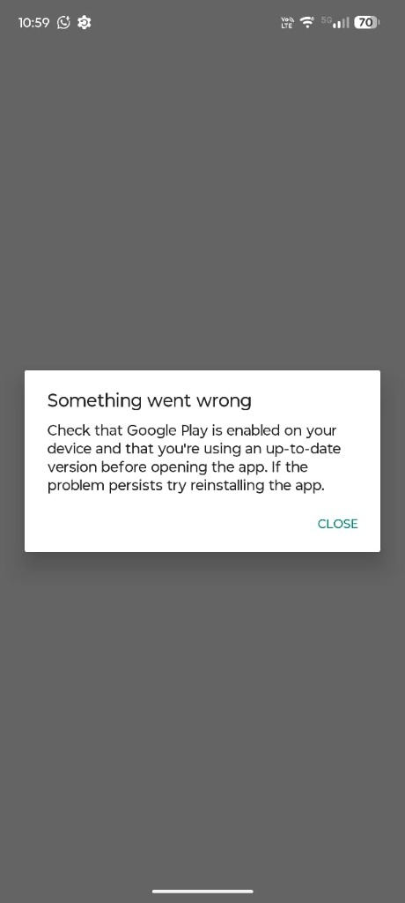

# 🔍 Case Study & Functional Validation: Play Integrity Incident in Government Apps (CNH & GOV.BR) and Play Store Restoration

**Device:** Motorola Edge 60 Pro (`XT2507-1`)  
**Codename:** `cybert` (`cybert_g_sys`)  
**Operating System:** Android 17 (API Level 37)  
**Build / Fingerprint:** `motorola/cybert_g_sys/cybert:17/A171VVH.36-27/7a1c2-08c719:user/release-keys`  
**SoC:** MediaTek Dimensity 8300 (`MT6897`)  
**Date of Incident and Remediation:** November 09, 2026  
**Homologation Status:** Level 3 — Integrity and subsystem functional validation approved  

---

## 1. Executive Summary

During real-world post-debloat and sandboxing verification on the Motorola Edge 60 Pro, the owner reported an inability to launch essential Brazilian government applications: the **Digital Driver's License / CNH Digital** (`br.gov.serpro.cnhe`) and the **GOV.BR** citizen authentication app (`br.gov.meugovbr`).

Upon opening either service, the application immediately aborted and presented a full-screen blocking modal stating:

> *"Something went wrong*  
> *Check that Google Play is enabled on your device and that you're using an up-to-date version before opening the app. If the problem persists try reinstalling the app."*



This case study documents the forensic root-cause analysis, the remediation procedure executed via Android Debug Bridge (ADB), runtime functional validation, and the resulting reinforcement of package protection policies in the **Clean My Android** repository.

---

## 2. Technical Diagnosis and Root Cause Analysis (RCA)

### 2.1. The Mechanism of the Play Integrity API
Both the CNH application (`br.gov.serpro.cnhe`) and GOV.BR (`br.gov.meugovbr`) embed the official **Google Play Integrity API** client library (successor to SafetyNet Attestation). This API provides cryptographically signed attestation of device environment integrity, package authenticity, and licensing before granting access to sensitive credentials (public digital identities, state-recognized licenses, and facial biometrics).

The client-side Play Integrity library behaves as follows:
1. Initiates an inter-process communication call (IPC via Android Binder) to the **Google Play Store** client service (`com.android.vending`).
2. Requests an *Integrity Token* signed by Google backend servers.
3. If package `com.android.vending` is disabled in `PackageManager`, the IPC connection fails with a non-recoverable error.
4. The client surfaces the standard Google Play Core dialog indicating that Google Play must be enabled and updated.

### 2.2. Root Cause in the Motorola Edge 60 Pro State
Forensic inspection of historical logs revealed:
1. **Disabled Google Play Store:** Package `com.android.vending` had been disabled for the primary user (`pm disable-user --user 0 com.android.vending`) and secondary profile (`User 11`), entering the internal state `COMPONENT_ENABLED_STATE_DISABLED_USER` (code `3`).
2. **Updates Uninstalled from `/data/app`:** `pm uninstall com.android.vending` had rolled back the store to the factory pre-installed base in `/product/priv-app/Phonesky/Phonesky.apk`.
3. **Disabled Verification and Policy Modules:** The following components were also placed in a disabled state:
   - `com.google.android.verifier` (Google Play Protect / App Verification Service);
   - `com.google.android.verifier.overlay` (Play Protect configuration overlay);
   - `com.google.android.configupdater` (Emergency, certificate, and timezone updater);
   - `com.google.android.gms.policy_sidecar_aps` (GMS policy sidecar).

This occurred despite `com.android.vending` already being cataloged in `data/protected_essential_packages.txt`, empirically confirming the validity of the warning flag published in the device report.

---

## 3. Restoration and Remediation Procedure (ADB)

The connection with the device was re-established via **Wireless ADB** using dynamic TLS pairing and connection on the local network (`192.168.1.X:PORTA_LOCAL`).

The following commands were executed to restore the packages and integrity subsystems:

```bash
# 1. Re-install and re-enable Google Play Store for User 0 and User 11
adb shell cmd package install-existing --user 0 com.android.vending
adb shell pm enable --user 0 com.android.vending
adb shell pm enable --user 11 com.android.vending
adb shell pm unsuspend --user 0 com.android.vending

# 2. Re-enable Play Protect verification and ConfigUpdater modules
adb shell cmd package install-existing --user 0 com.google.android.verifier
adb shell pm enable --user 0 com.google.android.verifier
adb shell cmd package install-existing --user 0 com.google.android.verifier.overlay
adb shell pm enable --user 0 com.google.android.verifier.overlay
adb shell cmd package install-existing --user 0 com.google.android.configupdater
adb shell pm enable --user 0 com.google.android.configupdater
adb shell pm enable --user 0 com.google.android.gms.policy_sidecar_aps

# 3. Force stop government apps to purge failed in-memory sessions
adb shell am force-stop br.gov.serpro.cnhe
adb shell am force-stop br.gov.meugovbr
adb shell am force-stop br.gov.dataprev.carteiradigital
```

### 3.1. Verification of System States
Following execution, `dumpsys package` confirmed state transition to `enabled=1` (`COMPONENT_ENABLED_STATE_ENABLED`):

```text
com.android.vending: User 0 enabled=1 | User 11 enabled=1
com.google.android.verifier: User 0 enabled=1
com.google.android.verifier.overlay: User 0 enabled=1
com.google.android.configupdater: User 0 enabled=1
com.google.android.gms.policy_sidecar_aps: User 0 enabled=1
```

System logcat verified that Google Play Store (`Finsky`) initialized hygiene services and refreshed the catalog cache:
```text
I Finsky  : [110] AIM: AppInfoManager-Perf > getApps > data collection finished
I Finsky  : [110] AU2: AppInfoManager-Perf > Successful cache refresh from hygiene.
```

All recovery actions were logged in JSONL format at `.cma-logs/actions.jsonl`.

---

## 4. Runtime Functional Validation

Following component reactivation:
1. **CNH Digital Execution:** The application `br.gov.serpro.cnhe` was launched on the Motorola Edge 60 Pro. Play Integrity verification completed successfully without displaying the error modal.
2. **Process Inspection:** Active execution was confirmed via `ps -A`:
   ```text
   USER     PID   PPID  VSZ      RSS    WCHAN ADDR S NAME
   u0_a446  18914 1641  25019920 253932 0     0    S br.gov.serpro.cnhe
   ```
3. **ActivityTaskManager Inspection:**
   ```text
   ActivityTaskManager: START u0 {act=android.intent.action.MAIN cat=[android.intent.category.LAUNCHER] cmp=br.gov.serpro.cnhe/.MainActivity} from uid 10499 (app.lawnchair.play)
   ```
   The main authentication view loaded fully, allowing access to digital driver documents.
4. **GOV.BR Application Status (`br.gov.meugovbr`):** With the Play Store and verification modules re-enabled (`enabled=1`) and previously failed sessions terminated via `am force-stop`, the underlying cause of the Play Integrity failure was eliminated at the operating system level. Foreground end-to-end execution was directly verified on CNH Digital (`br.gov.serpro.cnhe`), while GOV.BR had its subsystem dependencies restored, pending subsequent in-person user login validation.

---

## 5. Canonical Confirmation of Operating System Properties

During the active ADB session, canonical system properties previously flagged as pending were retrieved directly from `getprop`:

| Property | ADB Command | Observed Canonical Value |
|---|---|---|
| **Android Version** | `getprop ro.build.version.release` | `17` |
| **API Level (SDK)** | `getprop ro.build.version.sdk` | `37` |
| **Incremental Version** | `getprop ro.build.version.incremental` | `7a1c2-08c719` |
| **ROM Fingerprint** | `getprop ro.build.fingerprint` | `motorola/cybert_g_sys/cybert:17/A171VVH.36-27/7a1c2-08c719:user/release-keys` |
| **SoC / Platform** | `getprop ro.soc.model` | `MT6897` (MediaTek Dimensity 8300) |
| **Current Disabled Packages** | `pm list packages -d --user 0 \| wc -l` | **239 packages** (previously 244; 5 restored) |

---

## 6. Key Takeaways and Repository Guidelines

1. **`com.android.vending` is strictly essential for banking and government apps:** Even when the user relies on FOSS app stores (such as Aurora Store or F-Droid), the Play Store package is required at runtime by Play Integrity / SafetyNet client libraries. Disabling it breaks cryptographic attestation on critical identity and financial apps.
2. **Reversible without factory reset:** Restoring the packages via `pm enable --user 0` restored full functionality without requiring app reinstallation, factory wiping, or bootloader unlocking.
3. **Reinforced Protection Policies:**
   - Package `com.android.vending` is confirmed as non-negotiable in `data/protected_essential_packages.txt`.
   - Preservation is recommended to be extended to packages `com.google.android.verifier` and `com.google.android.configupdater` in environments utilizing Play Integrity attestation.
