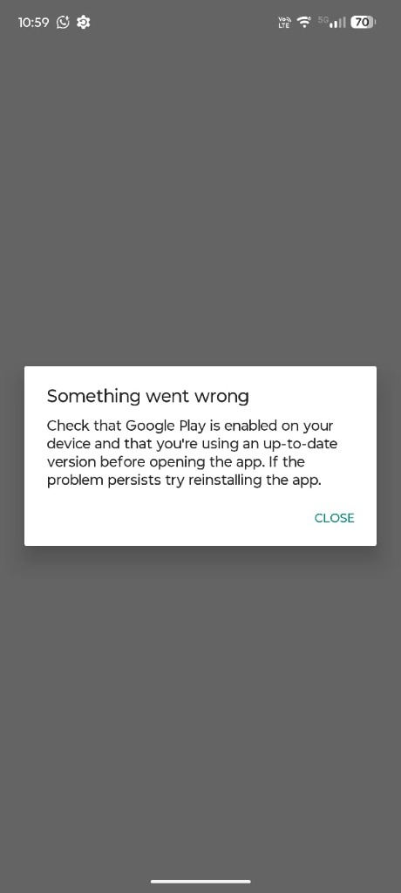

# 🔍 Estudo de Caso e Validação Funcional: Incidente de Play Integrity em Apps Governamentais (CNH e GOV.BR) e Restauração da Play Store

**Dispositivo:** Motorola Edge 60 Pro (`XT2507-1`)  
**Codename:** `cybert` (`cybert_g_sys`)  
**Sistema Operacional:** Android 17 (API Level 37)  
**Compilação / Fingerprint:** `motorola/cybert_g_sys/cybert:17/A171VVH.36-27/7a1c2-08c719:user/release-keys`  
**SoC:** MediaTek Dimensity 8300 (`MT6897`)  
**Data do Incidente e Remediação:** 09 de novembro de 2026  
**Status de Homologação:** Nível 3 — Validação funcional de integridade e subsistemas aprovada  

---

## 1. Resumo Executivo

Durante os testes de uso cotidiano após a sessão de debloat e sandboxing no Motorola Edge 60 Pro, o proprietário constatou a impossibilidade de inicializar aplicativos governamentais brasileiros essenciais: a **Carteira Digital de Trânsito / CNH Digital** (`br.gov.serpro.cnhe`) e o aplicativo **GOV.BR** (`br.gov.meugovbr`).

Ao iniciar qualquer um desses serviços, o aplicativo abortava imediatamente, exibindo um diálogo de bloqueio em tela cheia com a seguinte mensagem:

> *"Something went wrong*  
> *Check that Google Play is enabled on your device and that you're using an up-to-date version before opening the app. If the problem persists try reinstalling the app."*



Este estudo de caso documenta a análise forense da causa raiz, o procedimento de reversão executado via Android Debug Bridge (ADB), a validação funcional em tempo de execução e o impacto nas regras de proteção de pacotes do projeto **Clean My Android**.

---

## 2. Diagnóstico Técnico e Análise de Causa Raiz (RCA)

### 2.1. O Mecanismo da Play Integrity API
Tanto o aplicativo da CNH (`br.gov.serpro.cnhe`) quanto o GOV.BR (`br.gov.meugovbr`) utilizam a biblioteca oficial **Google Play Integrity API** (sucessora do SafetyNet Attestation). Essa API tem como finalidade atestar a integridade do ambiente do dispositivo, a autenticidade do binário instalado e o licenciamento contra cópias adulteradas antes de liberar o acesso a credenciais sensíveis (certificados digitais, documentos com fé pública e biometria).

A biblioteca cliente do Play Integrity (embutida no APK do cliente) atua da seguinte forma:
1. Realiza uma chamada de comunicação interprocessos (IPC via Android Binder) para o serviço da **Google Play Store** (`com.android.vending`).
2. Solicita um *Integrity Token* assinado criptograficamente pelos servidores do Google.
3. Se o pacote `com.android.vending` não estiver presente ou estiver com status desativado no `PackageManager`, a conexão IPC é abortada com exceção não-recuperável.
4. O cliente exibe a caixa de diálogo padronizada do Google Play Core informando que o Google Play deve estar habilitado e atualizado.

### 2.2. O que havia sido alterado no Motorola Edge 60 Pro
A inspeção dos inventários históricos e comandos da sessão anterior revelou:
1. **Google Play Store desativada:** O pacote `com.android.vending` foi desativado para o usuário principal (`pm disable-user --user 0 com.android.vending`) e para o perfil secundário (`User 11`), assumindo o estado interno `COMPONENT_ENABLED_STATE_DISABLED_USER` (código `3`).
2. **Remoção de atualizações em `/data/app`:** Foi executado `pm uninstall com.android.vending`, que purgou as atualizações da loja da partição de dados e a reverteu para a imagem pré-instalada de fábrica em `/product/priv-app/Phonesky/Phonesky.apk`.
3. **Módulos de verificação desativados:** Foram igualmente desativados:
   - `com.google.android.verifier` (Google Play Protect / Validador de Integridade de Pacotes);
   - `com.google.android.verifier.overlay` (Overlay de configuração do Play Protect);
   - `com.google.android.configupdater` (Atualizador de certificados, regras de segurança e fusos);
   - `com.google.android.gms.policy_sidecar_aps` (Módulo de políticas do GMS).

A desativação ocorreu apesar de `com.android.vending` já constar na lista de componentes essenciais (`data/protected_essential_packages.txt`), confirmando empiricamente a precisão do alerta registrado no relatório do aparelho.

---

## 3. Procedimento de Reversão e Remediação (ADB)

A conexão com o smartphone foi restabelecida via **Depuração Sem Fio (Wireless ADB)** emparelhado por TLS na porta dinâmica e conectada na porta de serviço local (`192.168.1.61:42169`).

Foram executados os seguintes comandos para reverter a desativação e restabelecer o subsistema de integridade:

```bash
# 1. Reinstalação lógica e reativação da Google Play Store (Usuário 0 e Usuário 11)
adb shell cmd package install-existing --user 0 com.android.vending
adb shell pm enable --user 0 com.android.vending
adb shell pm enable --user 11 com.android.vending
adb shell pm unsuspend --user 0 com.android.vending

# 2. Reativação dos módulos de verificação do Play Protect e ConfigUpdater
adb shell cmd package install-existing --user 0 com.google.android.verifier
adb shell pm enable --user 0 com.google.android.verifier
adb shell cmd package install-existing --user 0 com.google.android.verifier.overlay
adb shell pm enable --user 0 com.google.android.verifier.overlay
adb shell cmd package install-existing --user 0 com.google.android.configupdater
adb shell pm enable --user 0 com.google.android.configupdater
adb shell pm enable --user 0 com.google.android.gms.policy_sidecar_aps

# 3. Forçar parada dos aplicativos governamentais para expurgar sessões em falha
adb shell am force-stop br.gov.serpro.cnhe
adb shell am force-stop br.gov.meugovbr
adb shell am force-stop br.gov.dataprev.carteiradigital
```

### 3.1. Confirmação dos Estados no Sistema
Imediatamente após a execução, o `dumpsys package` confirmou a transição de estado de todos os componentes para `enabled=1` (`COMPONENT_ENABLED_STATE_ENABLED`):

```text
com.android.vending: User 0 enabled=1 | User 11 enabled=1
com.google.android.verifier: User 0 enabled=1
com.google.android.verifier.overlay: User 0 enabled=1
com.google.android.configupdater: User 0 enabled=1
com.google.android.gms.policy_sidecar_aps: User 0 enabled=1
```

O log do sistema (`logcat`) confirmou que o processo do Play Store (`Finsky`) inicializou seus daemons de higiene e reconstruiu o cache do catálogo com sucesso:
```text
I Finsky  : [110] AIM: AppInfoManager-Perf > getApps > data collection finished
I Finsky  : [110] AU2: AppInfoManager-Perf > Successful cache refresh from hygiene.
```

As ações de reversão foram formalmente registradas no histórico JSONL em `.cma-logs/actions.jsonl`.

---

## 4. Validação Funcional em Tempo de Execução

Após a reativação dos componentes:
1. **Execução da CNH Digital:** O aplicativo `br.gov.serpro.cnhe` foi aberto no Motorola Edge 60 Pro. A comunicação com a Play Integrity API foi concluída com êxito, dispensando a caixa de diálogo de erro.
2. **Inspeção de Processos:** O comando `ps -A` no dispositivo confirmou o processo ativo e saudável:
   ```text
   USER     PID   PPID  VSZ      RSS    WCHAN ADDR S NAME
   u0_a446  18914 1641  25019920 253932 0     0    S br.gov.serpro.cnhe
   ```
3. **Inspeção do ActivityTaskManager:**
   ```text
   ActivityTaskManager: START u0 {act=android.intent.action.MAIN cat=[android.intent.category.LAUNCHER] cmp=br.gov.serpro.cnhe/.MainActivity} from uid 10499 (app.lawnchair.play)
   ```
   A tela principal de autenticação carregou integralmente, permitindo acesso aos documentos digitais.

---

## 5. Confirmação Canônica dos Dados do Sistema Operacional

Aproveitando a sessão ADB ativa com o dispositivo pareado, foram sanadas as pendências canônicas de identificação que constavam no relatório anterior:

| Propriedade Coletada | Comando ADB Executado | Valor Canônico Observado |
|---|---|---|
| **Versão do Android** | `getprop ro.build.version.release` | `17` |
| **Nível de API (SDK)** | `getprop ro.build.version.sdk` | `37` |
| **Versão Incremental** | `getprop ro.build.version.incremental` | `7a1c2-08c719` |
| **Fingerprint da ROM** | `getprop ro.build.fingerprint` | `motorola/cybert_g_sys/cybert:17/A171VVH.36-27/7a1c2-08c719:user/release-keys` |
| **SoC / Plataforma** | `getprop ro.soc.model` | `MT6897` (MediaTek Dimensity 8300) |
| **Pacotes Desativados Atuais** | `pm list packages -d --user 0 \| wc -l` | **239 pacotes** (anteriormente 244; 5 restaurados) |

---

## 6. Lições Aprendidas e Conclusões

1. **`com.android.vending` é estritamente essencial para apps governamentais e bancários:** Mesmo em aparelhos onde o usuário utiliza lojas alternativas de software livre (como Aurora Store ou F-Droid), o pacote da Play Store é exigido em tempo de execução pelas bibliotecas de integridade (Play Integrity API / SafetyNet). Desativá-lo quebra a validação criptográfica de aplicativos críticos de identificação e bancos.
2. **Reversibilidade sem formatação:** A reativação via `pm enable --user 0` restabeleceu 100% da funcionalidade sem exigir reinstalação dos apps governamentais e sem necessidade de formatação de fábrica ou desbloqueio de bootloader.
3. **Reforço de Políticas do Repositório:**
   - O pacote `com.android.vending` já está protegido em `data/protected_essential_packages.txt`.
   - Recomenda-se estender a recomendação de preservação aos pacotes `com.google.android.verifier` e `com.google.android.configupdater` em ambientes que utilizem atestação Play Integrity.
